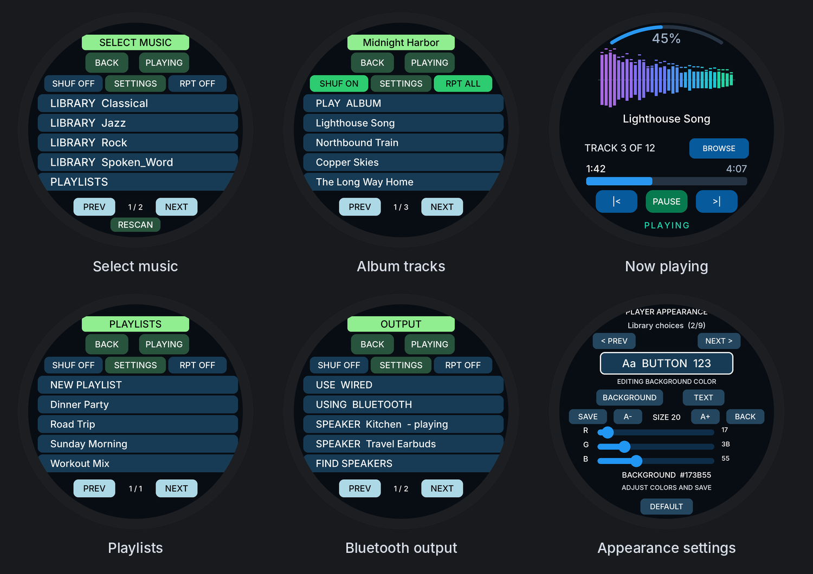
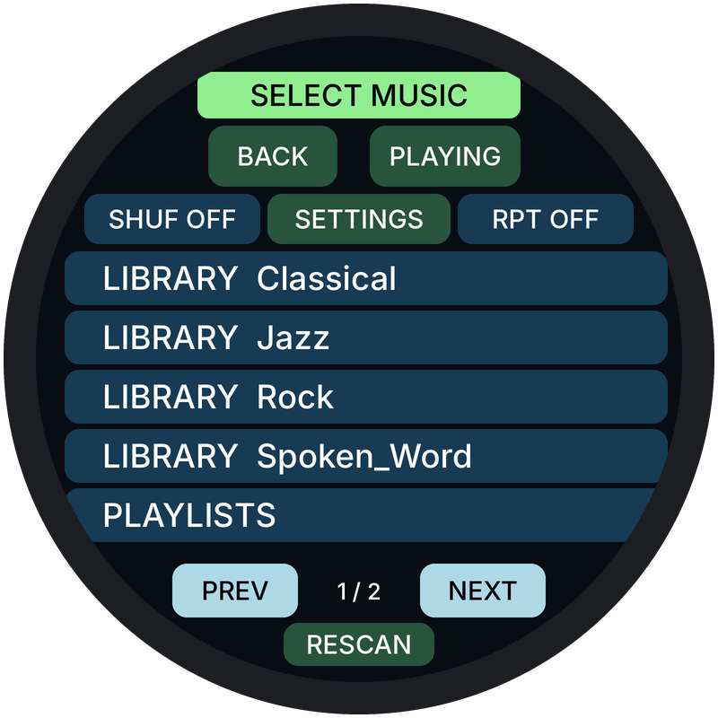
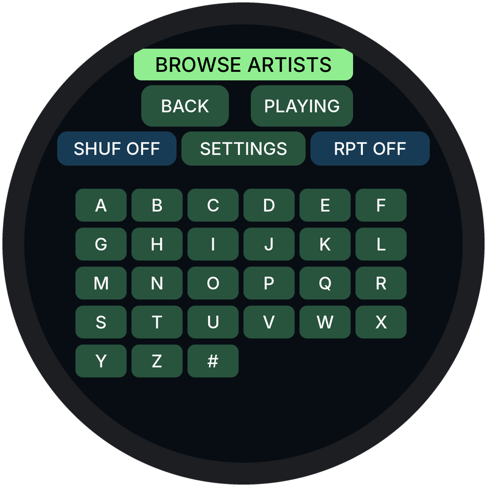
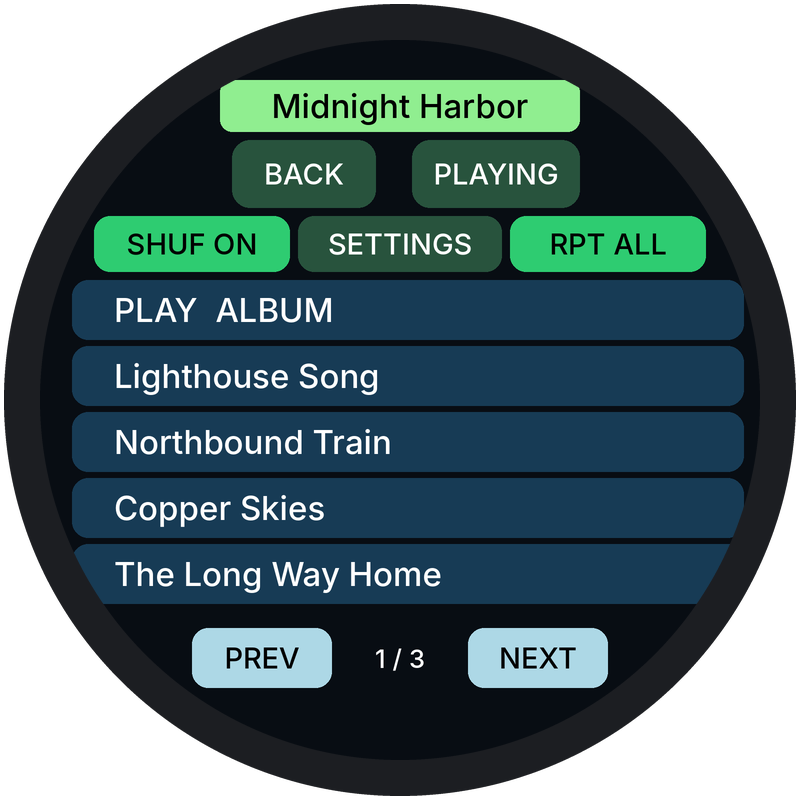
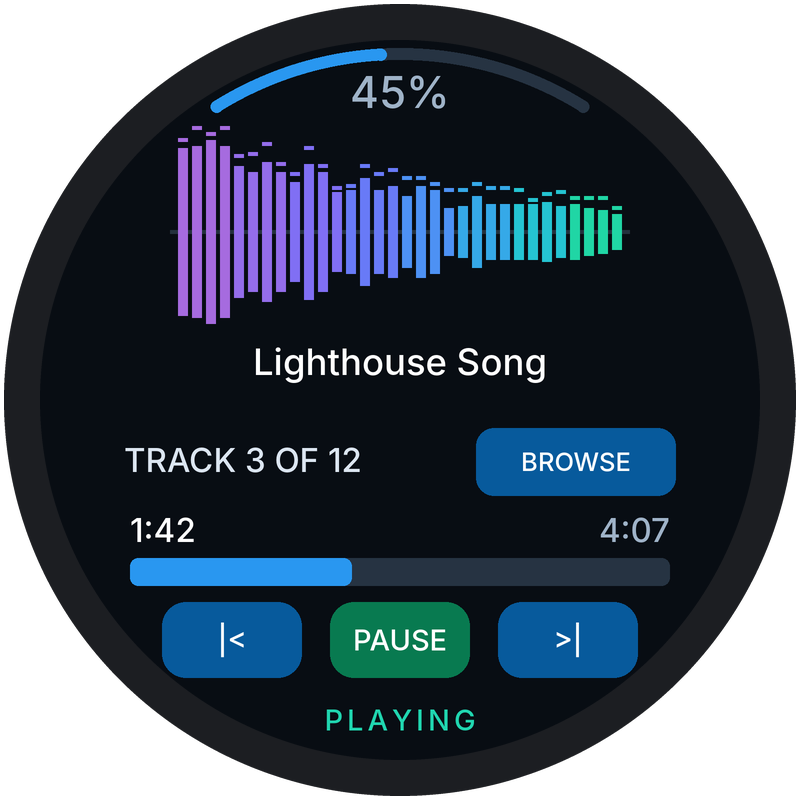
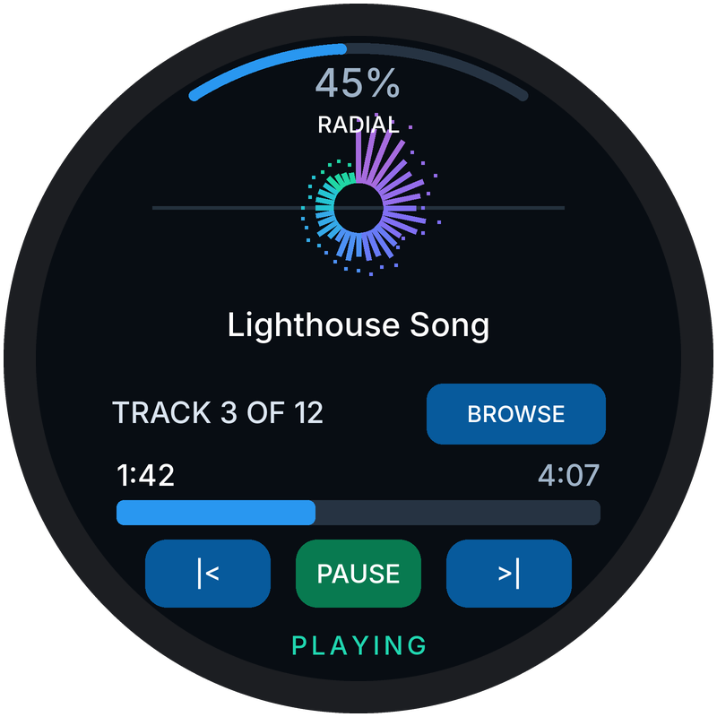
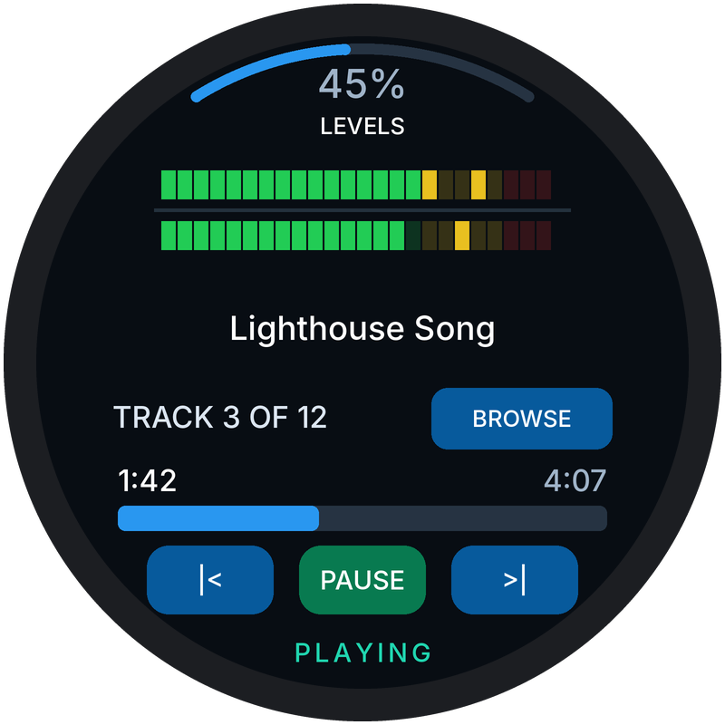
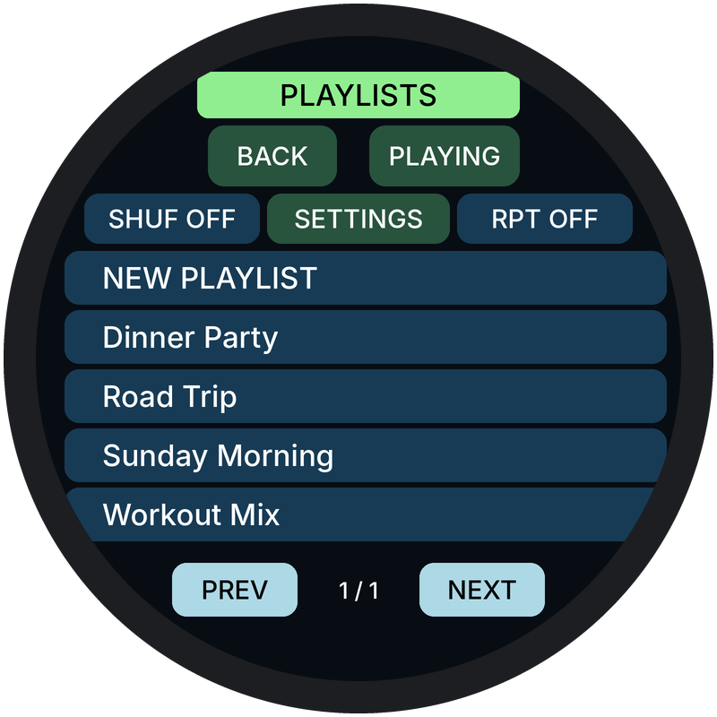
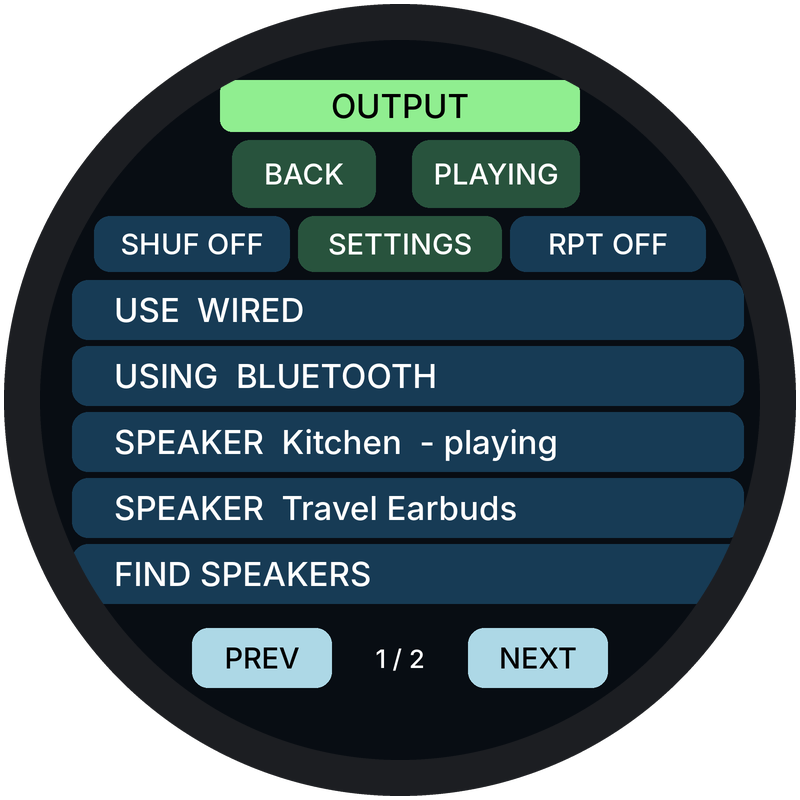
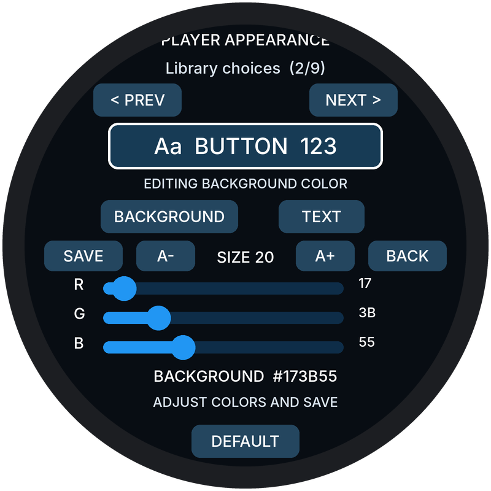

# RotaTune

**An MP3 music player for the Waveshare ESP32-S3-Knob-Touch-LCD-1.8**

RotaTune is an open-source, dual-processor music player for the **Waveshare ESP32-S3-Knob-Touch-LCD-1.8**, a development board with a round 360×360 touch display and a rotary encoder. It plays music from a microSD card through the 3.5 mm jack, or through a Bluetooth speaker or earbuds. The ESP32-S3 runs the player; the board's second chip, an ESP32, handles Bluetooth.

RotaTune is an independent project and is not made or endorsed by Waveshare.



*The screen images are drawn from the layout in the source code and use invented sample music. They are not photos of the device.*

## Features

- **Music libraries:** each folder in `Music_Library` on the SD card is a library, up to 8. You can browse a library by artist, album or song (each A–Z), or folder by folder. **PLAY ALBUM** and **PLAY FOLDER** play a whole album or folder.
- **Fast browsing:** the player builds an index of each library on the SD card. It keeps the index of the library you're browsing in PSRAM, so even libraries with thousands of songs page quickly. **RESCAN** rebuilds the indexes after you add music.
- **Playlists:** create, play, add tracks to and delete M3U playlists on the device. They are stored in `Music_Library/Playlists`. Playlists made on a PC also work, including Windows paths.
- **Shuffle and repeat:** shuffle can be on or off; repeat can be off, all or one track.
- **Spectrum display:** tap the spectrum to switch between Mirror, Bars, Radial, Scope, Levels and Off.
- **Rotary encoder:** sets the volume while playing, and turns pages in the browser.
- **Bluetooth output:** find speakers, keep two saved speakers, and switch between wired and Bluetooth from the Output page. The knob sets the speaker's own volume (AVRCP). Playback continues if the speaker goes out of range.
- **Appearance settings:** change the colours and font sizes on the device. They are saved to the SD card.

| | | |
|---|---|---|
|  |  |  |
|  |  |  |
|  |  |  |

## Hardware

- Waveshare ESP32-S3-Knob-Touch-LCD-1.8. It has an ESP32-S3R8 (8 MB PSRAM, 16 MB flash), an ESP32-U4WDH, a PCM5100A DAC, a 3.5 mm jack and a microSD slot.
- A microSD card formatted FAT32 (see [SD card](#sd-card) below).
- Optional: an A2DP Bluetooth speaker or earbuds.

Both chips are on the board, and the link between them is the board's own wiring (S3 GPIO38/48 ↔ ESP32 GPIO18/23, UART at 3 Mbaud). You don't need to add any wires.

## Repository layout

```
firmware/RotaTune/                      ESP32-S3 sketch (player, display, SD card)
firmware/RotaTune_Bluetooth/            ESP32 sketch (Bluetooth A2DP source; also unmutes the DAC)
firmware/lv_conf.h                      LVGL configuration used during development
docs/images/                            screen images
tools/render_screens.py                 script that draws the screen images
```

`link_protocol.h` must be identical in both sketch folders.

## Back up the original firmware first

Before you upload anything, save the factory firmware of **both** chips, so you can put the board back the way it came. This uses `esptool`, which comes with the Arduino ESP32 core. You can also install it with `pip install esptool`.

Connect the board and find the serial port of each chip (in Windows, look in Device Manager; for example COM5). Then run, with your port numbers:

```
# ESP32-S3: 16 MB flash
esptool --chip esp32s3 --port COM5 read-flash 0 0x1000000 backup_esp32s3.bin

# ESP32 (U4WDH): 4 MB flash
esptool --chip esp32 --port COM6 read-flash 0 0x400000 backup_esp32.bin
```

Each read takes a few minutes. Keep both `.bin` files somewhere safe. To restore a chip later:

```
esptool --chip esp32s3 --port COM5 write-flash 0 backup_esp32s3.bin
esptool --chip esp32   --port COM6 write-flash 0 backup_esp32.bin
```

Older esptool versions (before v5) use `esptool.py` and spell the commands `read_flash` / `write_flash`.

## Building

### Arduino environment (versions used during development)

| Item | Version | Where to get it |
|---|---|---|
| esp32 board package by Espressif Systems | 3.3.11 | Boards Manager |
| lvgl | 8.4.0 | Library Manager (use with `firmware/lv_conf.h`) |
| DevLab_AudioTools (Phil Schatzmann and others) | 1.2.7 | Library Manager |
| DevLab_LibHelix (MP3 decoder for AudioTools) | 0.9.4 | Library Manager |
| ESP32-A2DP (Phil Schatzmann), ESP32 sketch only | 1.8.12 | Not in Library Manager: download from [github.com/pschatzmann/ESP32-A2DP](https://github.com/pschatzmann/ESP32-A2DP) |

To install ESP32-A2DP:
1. On its GitHub page, click **Code → Download ZIP**, or download version 1.8.12 from its Releases page.
2. In the Arduino IDE, choose **Sketch → Include Library → Add .ZIP Library…** and pick the downloaded file.

Copy `firmware/lv_conf.h` into your Arduino `libraries` folder, next to the `lvgl` folder. It enables the Montserrat fonts 12–28, sets a 48 KB LVGL memory pool and sets `LV_COLOR_16_SWAP 1`, which this display needs. With an `lv_conf.h` that has `LV_COLOR_16_SWAP 0`, every colour is wrong and edges look jagged.

### ESP32-S3 (player)

1. Open `firmware/RotaTune/RotaTune.ino`.
2. Board settings:
   - Board: **ESP32S3 Dev Module**
   - Flash size: **16MB**
   - PSRAM: **OPI PSRAM**
   - Partition scheme: **16M Flash (3MB APP/9.9MB FATFS)**
3. Upload. The firmware is about 1 MB.

### ESP32 (Bluetooth)

1. Open `firmware/RotaTune_Bluetooth/RotaTune_Bluetooth.ino`.
2. Board: **ESP32 Dev Module**. Partition scheme: **Huge APP (3MB No OTA/1MB SPIFFS)**.
3. Upload to the board's ESP32 chip.
   <!-- TODO: describe how to select the ESP32 chip for uploading on this board. -->

**Install the ESP32 sketch even if you only use wired output.** The DAC's mute pin (PCM5100A XSMT) is connected to the ESP32's GPIO32. The sketch sets it HIGH (unmuted) first thing at start-up; without that, the 3.5 mm jack may stay silent. (The S3 sketch also drives its own DAC enable pin, GPIO0, HIGH.)

## SD card

Use the largest microSD card you have room for, and copy all the music you want onto it with a card reader before the first boot. Until the planned Wi-Fi file manager exists, the only way to change the music is to take the card out and use a PC.

- **Format:** FAT32 (the format this player was developed and tested with). Cards of 64 GB and larger usually come formatted exFAT. Windows' own format tool won't format cards that large as FAT32, so use a third-party tool such as Rufus or "FAT32 Format" (guiformat).
- **Files:** MP3 only.
- **Large libraries are fine:** the player was developed with a library of about 7,500 songs. The first scan of a large library takes a while; after that the saved index is used.

### SD card layout

```
/Music_Library/
    Rock/                 ← each folder here is a library (up to 8, sorted by name)
        Artist/Album/01 Track.mp3
    Jazz/
    Playlists/            ← created by the player; .m3u files
    .player_index/        ← created by the player; one index file per library
player_colors.txt         ← optional; written by SETTINGS → SAVE
```

At first boot the player scans each library and writes its index, which takes a while for large libraries. After you add or remove music, tap **RESCAN** on the Select Music page, then tap it again to confirm. New library folders are also found at boot.

## Using it

The full **[User Guide](docs/USER_GUIDE.md)** ([PDF](docs/RotaTune_User_Guide.pdf)) explains every screen. In brief:


- **Select Music page:** choose a library, PLAYLISTS, or OUTPUT (on page 2). SHUF, SETTINGS and RPT are along the top.
- **Turning the knob:** in the browser it turns pages; while playing it sets the volume.
- **Playing screen:**
  - Tap the spectrum to change its style.
  - Tap the progress bar to seek.
  - Tap the volume number under the arc to open the Output page.
  - BROWSE goes back to the library.
- **Output page:**
  - USE WIRED / USE BLUETOOTH switches the output.
  - FIND SPEAKERS searches for speakers; tap a found one to connect and save it.
  - SPEAKER rows switch between the saved speakers; FORGET removes one.
- **Playlists:** NEW PLAYLIST opens a keyboard for the name. ADD TRACKS lets you browse normally, and each track or album you tap is added. Tap DONE ADDING to finish.

## Licence

This project is licensed under the **GNU General Public License v3.0** (see `LICENSE`). It uses AudioTools (DevLab_AudioTools, originally arduino-audio-tools by Phil Schatzmann), which is also GPL-3.0.

Some files come from other sources and keep their own licences:
- `esp_lcd_sh8601.c/.h` and `bidi_switch_knob.c/.h`: Espressif Systems, Apache-2.0 (see the file headers).
- `lcd_bsp.c/.h`, `lcd_bl_pwm_bsp.c/.h`, `cst816.cpp/.h`, `sd_card_bsp.cpp/.h`, `lcd_config.h`: based on Waveshare's demo code for this board, with changes.
- LVGL (MIT), ESP32-A2DP (Apache-2.0), AudioTools (GPL-3.0) and LibHelix are used as libraries and are not included here.

## Status

Version 0.18.0 is the first public release.
- **Tested on hardware:** wired playback, browsing, playlists, shuffle and repeat, spectrum styles and Bluetooth output (two speakers and earbuds).
- **Planned:** a Wi-Fi file manager (active only when not playing) and simple games.
