# RotaTune User Guide

*An MP3 music player for the Waveshare ESP32-S3-Knob-Touch-LCD-1.8*

This guide explains how to use the player day to day. To install the firmware, see the [README](../README.md).

*The screen images show the default colours and made-up music. Your screen will show your own music, and the colours may look a little different on the real display.*

## Contents
1. [The controls](#1-the-controls)
2. [First start and library scan](#2-first-start-and-library-scan)
3. [Browsing music](#3-browsing-music)
4. [The playing screen](#4-the-playing-screen)
5. [Shuffle and repeat](#5-shuffle-and-repeat)
6. [Playlists](#6-playlists)
7. [Bluetooth speakers and earbuds](#7-bluetooth-speakers-and-earbuds)
8. [Changing colours and text size](#8-changing-colours-and-text-size)
9. [Adding or changing music](#9-adding-or-changing-music)
10. [Troubleshooting](#10-troubleshooting)

---

## 1. The controls

You use the player with the **touchscreen** and the **knob**.

- **Touchscreen:** tap a button or a row to select it.
- **Knob, on the browse screens:** turns the pages of a list, one page per click. The knob doesn't press in, so you still tap the screen to choose an item.
- **Knob, on the playing screen and in Settings:** sets the volume.

Most browse screens have the same controls along the top:

| Button | What it does |
|---|---|
| **BACK** | Goes back one level. |
| **PLAYING** | Returns to the playing screen. This only works once something is playing. |
| **SHUF** | Turns shuffle on or off (see [section 5](#5-shuffle-and-repeat)). |
| **SETTINGS** | Opens the colour and text-size settings. |
| **RPT** | Changes the repeat setting. |

A list shows 5 rows at a time. **PREV** and **NEXT** at the bottom change the page, or you can turn the knob. The number between them, for example `1 / 3`, is the page you're on and the number of pages.

## 2. First start and library scan

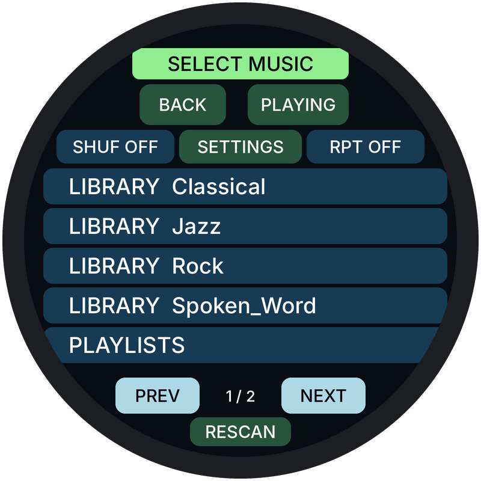

When the player starts, it looks at the folders inside `Music_Library` on the SD card. Each folder is a **library**: for example, one for each family member, or one for music and one for audiobooks.

The first time it sees a library, the player reads every song in it and saves an **index**, a list of artists, albums and tracks. The screen shows `COUNTING ... FILES` and then `SCANNING ...`, with a progress bar. A large library takes several minutes. After that the player uses the saved index and starts quickly.

The **Select Music** page lists:
- The libraries, shown as `LIBRARY  name`.
- **PLAYLISTS**.
- The current output, **OUTPUT  WIRED** or **OUTPUT  BLUETOOTH**. With four or more libraries, this row is on page 2.

**RESCAN** at the bottom rebuilds all the indexes; [section 9](#9-adding-or-changing-music) explains when to use it.

## 3. Browsing music

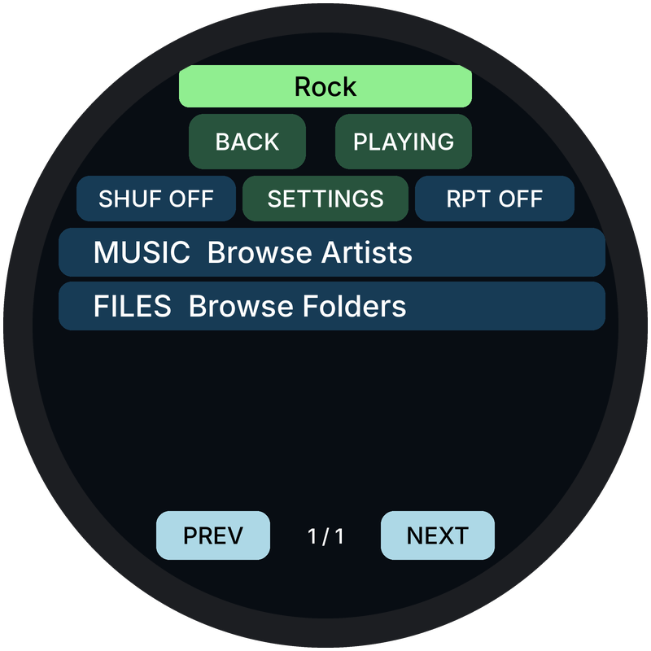

Tap a library, then choose how to browse it:

- **MUSIC  Browse Artists:** browse by artist, then album, then track. This uses the song tags (artist, album, track number).
- **FILES  Browse Folders:** browse the folders exactly as they are on the card.

### By artist

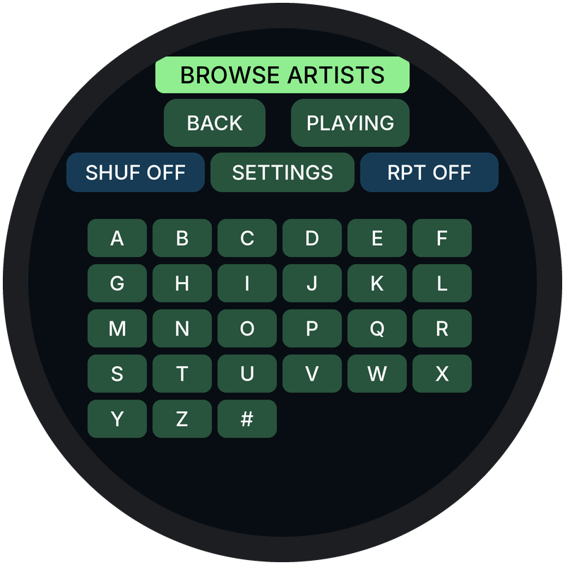 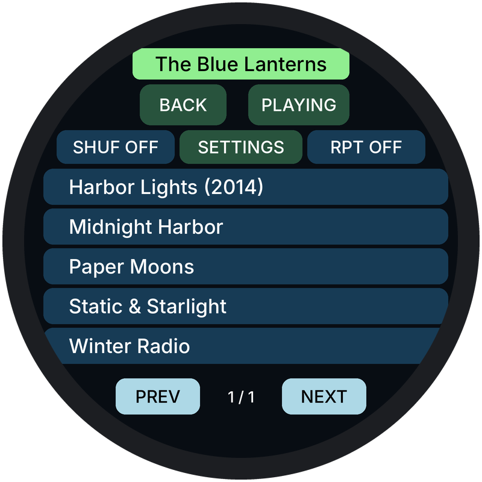

1. Tap the first letter of the artist's name. **#** covers names that start with a number or symbol.
2. Tap the artist to see their albums.
3. Tap an album to see its tracks.

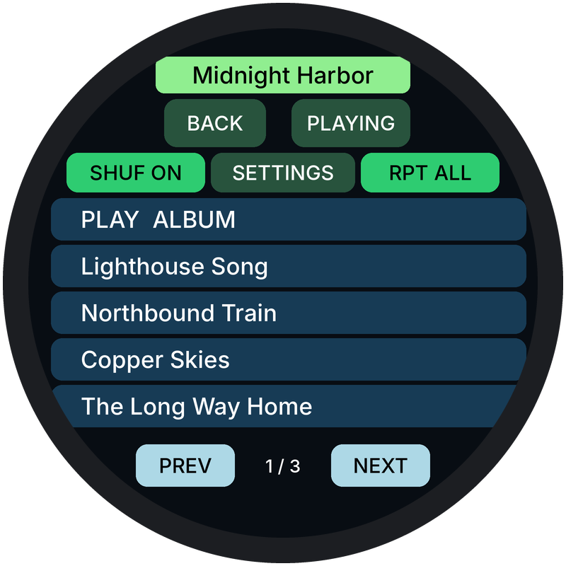

On the track list:
- **PLAY  ALBUM** plays the whole album from the first track. With shuffle on, it starts on a random track instead.
- **Tapping a track** plays it, then carries on through the rest of the album.

### By folder

Folders appear as `FOLDER  name` and songs as `TRACK  name`.
- Tap a folder to open it.
- **PLAY  FOLDER** at the top plays every song in that folder.
- Tapping a track plays it and then carries on through the rest of the folder.

## 4. The playing screen

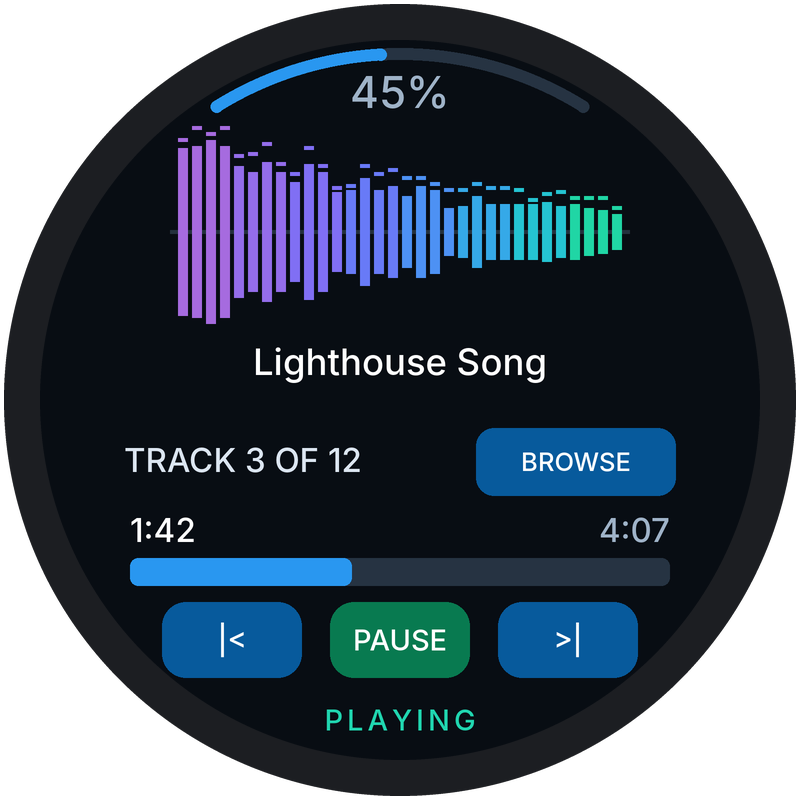

| Part | What it does |
|---|---|
| **Volume line** (top) | Shows the volume. **Tap it** to open the Output page. |
| **Spectrum** | Moves with the music. **Tap it** to change the style. |
| **Title** | The song title, from its tags or file name. |
| **TRACK n OF m** | Where you are in the current album, folder or playlist. |
| **BROWSE** | Goes back to the browser. The music keeps playing. |
| **\|<** / **>\|** | Previous and next track. |
| **PAUSE / PLAY** | Pauses or resumes the music. |
| **Progress bar** | Shows how far into the song you are. **Touch and slide** along it to jump to another point; the song continues from where you let go. |
| **Times** | Time played (left) and the song's length (right). |
| **Status** (bottom) | PLAYING, PAUSED, STOPPED or READY. |

Turn the knob to change the volume. It moves 2% per click.

When the current album, folder or playlist ends, playback stops. If RPT is set to ALL, it starts again from the beginning instead.

### Spectrum styles

| 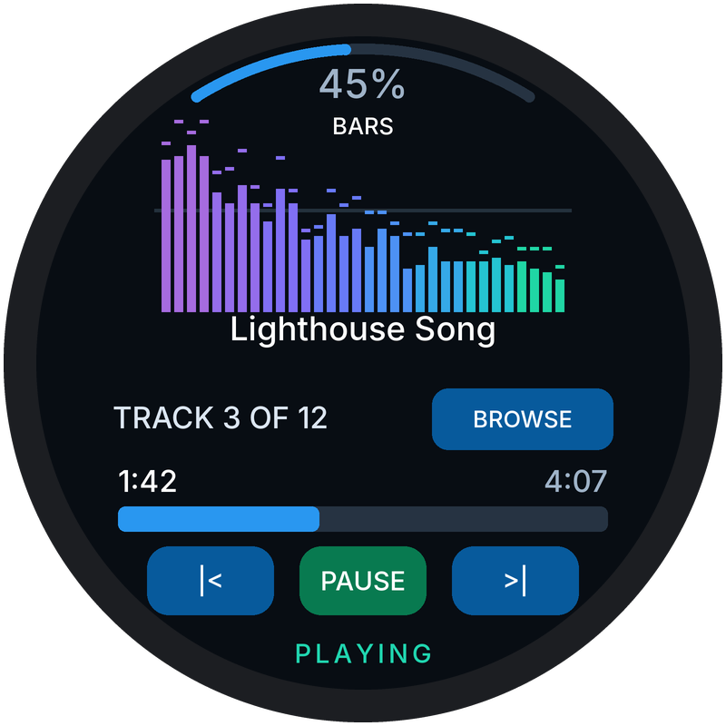 | 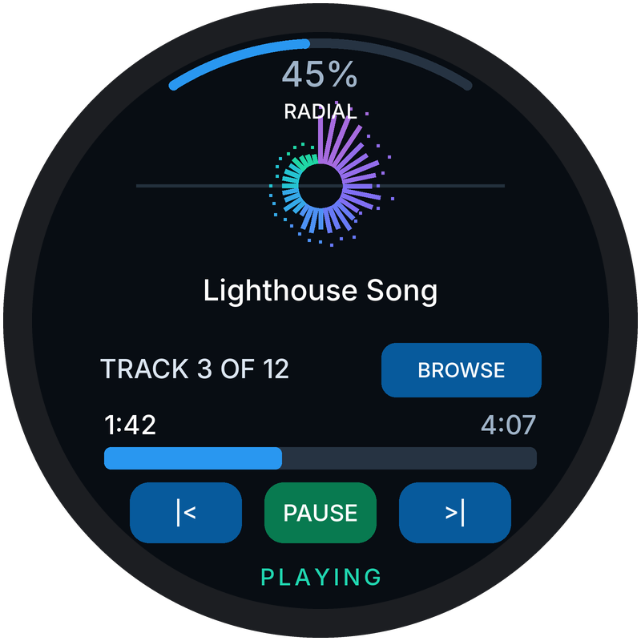 |
|---|---|
| 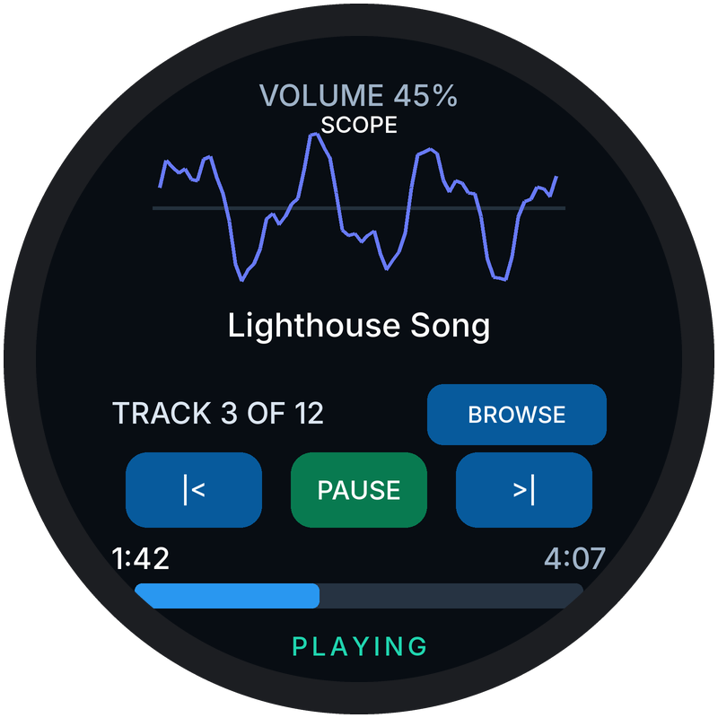 | 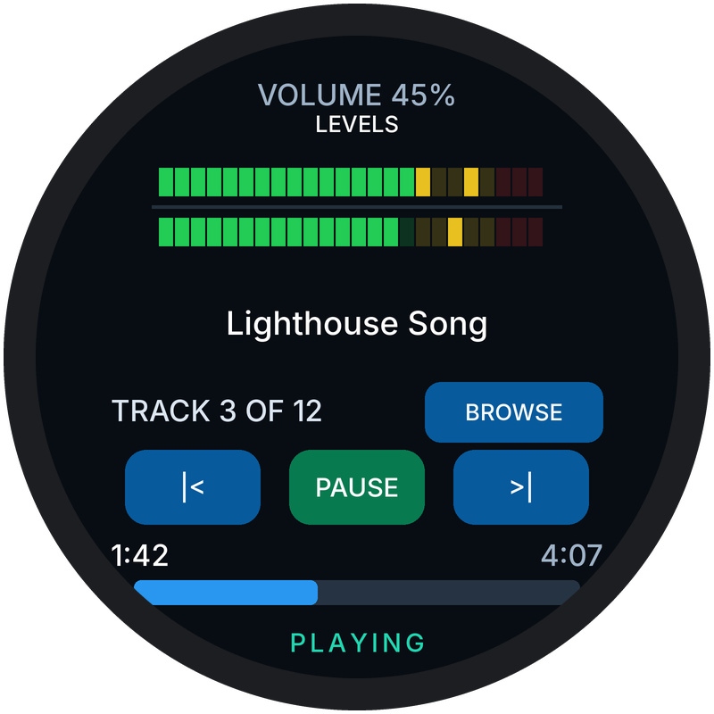 |

Each tap on the spectrum moves to the next style, and its name shows for a moment:

| Style | What it shows |
|---|---|
| **MIRROR** | 32 frequency bars, from bass on the left to treble on the right, mirrored above and below a centre line. This is the default. |
| **BARS** | The same 32 bars, rising from the bottom. |
| **RADIAL** | The bars arranged in a circle. |
| **SCOPE** | The sound wave itself. |
| **LEVELS** | Left and right loudness meters, from green through yellow to red. |
| **SPECTRUM OFF** | Nothing is drawn. This saves a little battery. |

The player remembers your choice after a restart.

## 5. Shuffle and repeat

The **SHUF** and **RPT** buttons are at the top of the browse screens. When a setting is on, the button turns bright green.

- **SHUF OFF / SHUF ON:**
  - Shuffle plays the current album, folder or playlist in random order.
  - If you turn it on while a song is playing, that song finishes and the rest follow in random order.
  - With shuffle on, PLAY ALBUM, PLAY FOLDER and PLAY ALL start on a random track.
  - Shuffle is always **off** when the player starts.
- **RPT** changes each time you tap it:
  - **RPT OFF:** playback stops after the last track.
  - **RPT ALL:** after the last track, it starts again from the first.
  - **RPT 1:** the current song repeats. **>|** and **|<** still move to other songs.
  - The player remembers the repeat setting after a restart.

## 6. Playlists

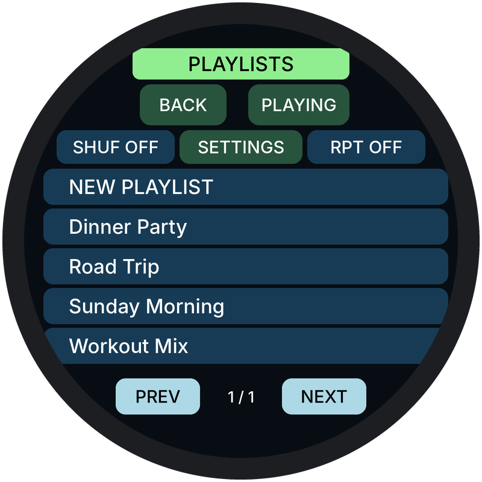

Tap **PLAYLISTS** on the Select Music page to see your playlists, listed in alphabetical order.

### Creating a playlist
1. Tap **NEW PLAYLIST**. A keyboard appears.
2. Type a name of up to 40 characters, using letters, numbers, spaces, `-` and `_`, then press the keyboard's ✓ key.
3. The new, empty playlist opens.

If a playlist with that name already exists, it opens instead.

### Inside a playlist

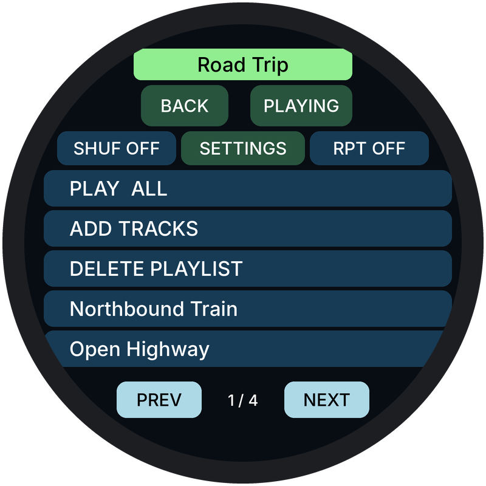

| Row | What it does |
|---|---|
| **PLAY  ALL** | Plays the whole playlist. With shuffle on, it starts on a random track. |
| **ADD TRACKS** | Lets you browse your music and add songs (see below). |
| **DELETE PLAYLIST** | Deletes the playlist. Tap once and it changes to **TAP AGAIN TO DELETE PLAYLIST**; tap it again to delete. Tapping anything else cancels. |
| *Track names* | Tap a track to play the playlist from that track. |

### Adding tracks
1. Open the playlist and tap **ADD TRACKS**. The heading changes to **ADD TO** *playlist name*.
2. Browse your music as usual, by artist or by folder.
3. Add music:
   - Tap a **track** to add it.
   - Tap **ADD  ALBUM** or **ADD  FOLDER** to add every track in that album or folder.
   - The heading briefly shows `ADDED n: name` to confirm.
4. When you're finished, tap **PLAYING**, or **DONE ADDING** on the Select Music page. Either one takes you back to the playlist.

Playlists are ordinary `.m3u` files in `Music_Library/Playlists`, so you can also make or edit them on a computer. The player understands playlists that use Windows paths (`E:\Music_Library\...`) and relative paths (`../Rock/...`).

## 7. Bluetooth speakers and earbuds

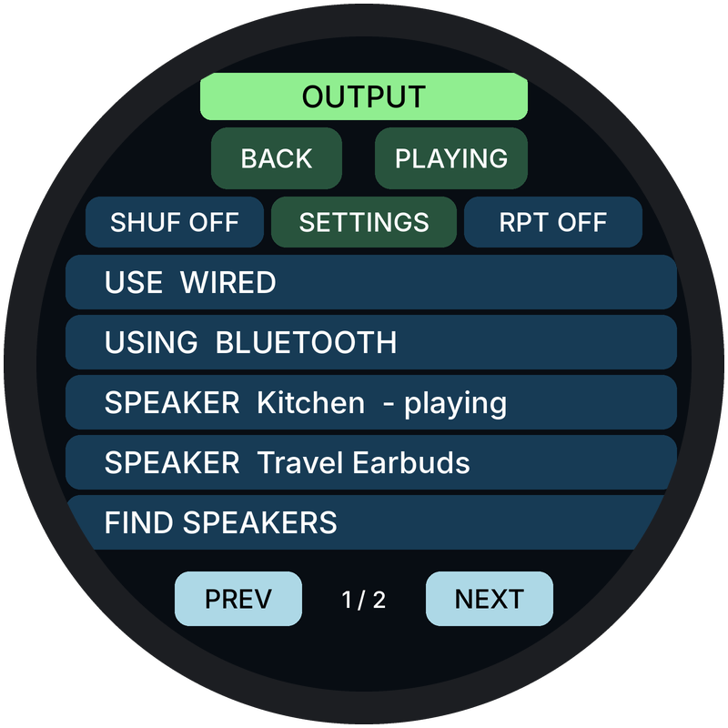

To open the **Output** page, tap the volume line on the playing screen, or tap the **OUTPUT** row on the Select Music page.

| Row | What it does |
|---|---|
| **USE  WIRED** / **USING  WIRED** | Plays through the 3.5 mm jack. **USING** marks the current output. |
| **USE  BLUETOOTH** / **USING  BLUETOOTH** | Plays through the Bluetooth speaker. |
| **SPEAKER  name** | One of your saved speakers (up to 2). Tap it to switch to that speaker. The active one shows its state: playing, connected, connecting or not connected. |
| **FIND SPEAKERS** | Searches for speakers nearby. |
| **FOUND  name  -60 dB** | A speaker the search found, with its signal strength (closer to 0 is stronger). Tap it to connect and save it. |
| **FORGET  name** | Removes a saved speaker. |

### Connecting a new speaker for the first time
1. Put the speaker in pairing mode.
2. On the Output page, tap **FIND SPEAKERS**. The Bluetooth chip restarts to search, which takes a few seconds, and the row shows **(scanning)**.
3. When the speaker appears as a **FOUND** row, tap it.

The speaker is now saved. Next time, choose **USE BLUETOOTH** and the player reconnects to it by itself. With two speakers already saved, a new one replaces the one that isn't in use.

### Volume with Bluetooth
In Bluetooth mode, the knob sets the **speaker's own volume**, and the volume line shows `BT VOLUME n%`. If you change the volume on the speaker, the display follows it.

| Volume line shows | Meaning |
|---|---|
| `BT VOLUME 40%` | Connected and playing. |
| `BT 40%  WAITING` | No speaker is connected yet, or it's out of range. The player keeps going and reconnects when it can. |
| `BT 40%  NO LINK` | The player can't talk to its Bluetooth chip. Check that the Bluetooth firmware is installed (see the README). |

Switching back to wired is instant. Reconnecting to Bluetooth takes a few seconds. Bluetooth range is shorter than a phone's, so keep the speaker within a few metres.

## 8. Changing colours and text size

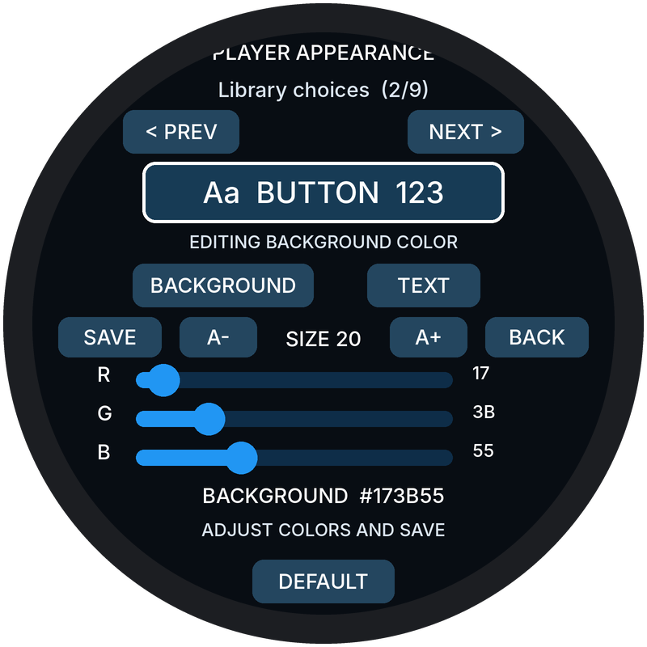

Tap **SETTINGS** on any browse screen to open the settings. You can change 9 parts of the display:

> Library header · Library choices · Browser list · PREV / NEXT · Page highlight · Browser controls · Playback screen · Playback buttons · Playback status

1. Use **< PREV** and **NEXT >** to choose a part. The box in the middle shows a preview.
2. Tap **BACKGROUND** or **TEXT** to choose which colour to change.
3. Move the **R**, **G** and **B** sliders (red, green, blue). The colour code is shown below the sliders.
4. Use **A-** and **A+** to change the text size, from 12 to 28.
5. Tap **SAVE**, then **restart the player** to see the changes everywhere.
6. Tap **BACK** to leave without saving.

**DEFAULT** puts back the original colours and sizes. Tap **SAVE** afterwards to keep them.

The settings are stored on the SD card in `player_colors.txt`.

**Tip:** the SHUF and RPT buttons use the **Library choices** colours when they're off. If your text is hard to read, a lighter background with dark text, or a darker one with white text, helps.

## 9. Adding or changing music

1. Turn the player off and take out the microSD card.
2. On a computer, copy music into a library folder, for example `Music_Library/Rock/Artist/Album/`. To add a new library, create a new folder directly inside `Music_Library`. You can have up to 8 libraries.
3. Put the card back and turn the player on.
4. On the Select Music page, tap **RESCAN**. It changes to **CONFIRM?** for 3 seconds; tap it again to start.

Rescanning reads every library again, which takes a while for large collections. New library folders are also found automatically at start-up.

**Song information:** browsing by artist uses the song tags. Songs with missing tags are easier to find with Browse Folders. Tidying the tags on a computer (artist, album, track number) gives the best results.

## 10. Troubleshooting

| Problem | What to try |
|---|---|
| No sound from the headphone jack | Check that **USING  WIRED** is selected on the Output page. The Bluetooth chip's firmware must be installed even for wired sound, because it turns the audio chip on (see the README). |
| No sound from the Bluetooth speaker | Check that the volume line doesn't say WAITING. Turn the speaker off and on, then tap its **SPEAKER** row. If that doesn't work, use **FORGET**, then **FIND SPEAKERS** again. |
| "No MP3 files found" | Make sure the music is in folders inside `Music_Library`, and the files are MP3. |
| A library or new songs don't appear | Tap **RESCAN** twice (see section 9). |
| An artist is missing from Browse Artists | The songs may have no artist tag. Try **Browse Folders**. |
| PLAYING does nothing | Nothing has been played yet since start-up. Choose some music first. |
| Colours didn't change after SAVE | Restart the player. |
| The screen is hard to read | Change the colours in **SETTINGS** (see section 8). |
| Playlist says "NO PLAYABLE TRACKS" | The songs in it were moved or renamed. Delete the playlist and make it again, or fix the paths on a computer. |
